<div align="center">

# Folio — Library Management Platform

**A secure REST API (NestJS · TypeORM · PostgreSQL) with a polished Bootstrap + Chart.js frontend.**
Browse a catalog grouped by category, manage favorites, and run the library as an administrator.


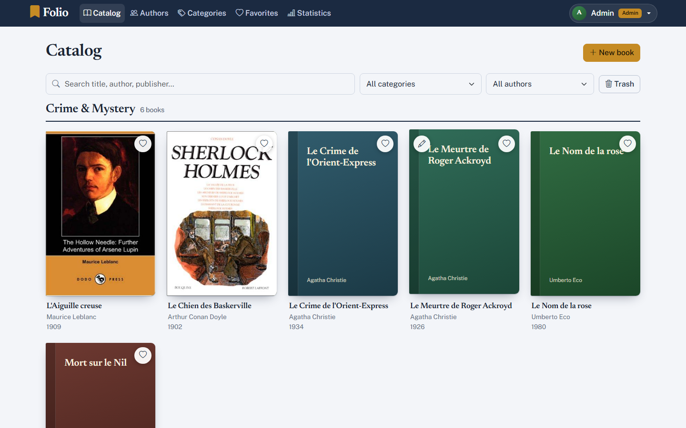

</div>

---

## Table of contents

1. [Overview](#overview)
2. [Screenshots](#screenshots)
3. [Features](#features)
4. [Quick start](#quick-start)
5. [Architecture](#architecture)
6. [Data model](#data-model)
7. [Roles and permissions](#roles-and-permissions)
8. [API reference](#api-reference)
9. [Security](#security)
10. [Specification compliance](#specification-compliance)
11. [Project structure](#project-structure)
12. [Configuration](#configuration)
13. [Design decisions](#design-decisions)
14. [Known limitations and roadmap](#known-limitations-and-roadmap)
15. [Author](#author)

---

## Overview

Folio manages a library of **books, authors, categories, favorites and users**.

- A **visitor** can sign up and sign in.
- A **signed-in user** browses the catalog and authors, manages personal favorites and edits their own profile.
- An **administrator** creates, edits, deletes (to a trash) and restores books, and manages authors, categories and statistics.

The **first account created on an empty database automatically becomes the administrator**; every following account is a regular user.

The backend serves both the REST API and the single-page frontend, so one command starts the whole platform.

---

## Screenshots

| Sign in | Catalog by category |
|:--:|:--:|
| 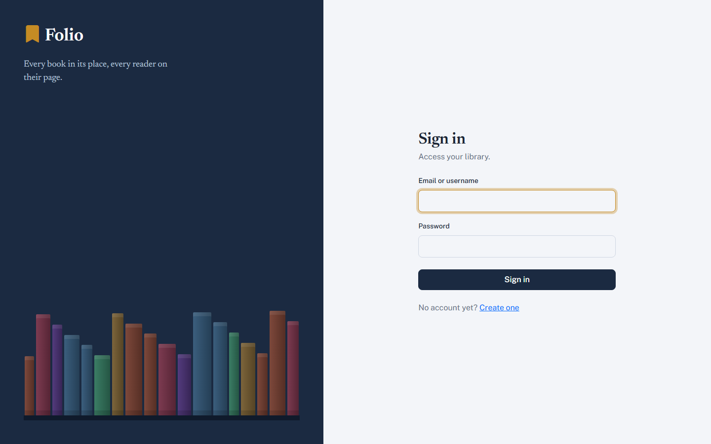 |  |

| Book details | Add / edit form (modal) |
|:--:|:--:|
| 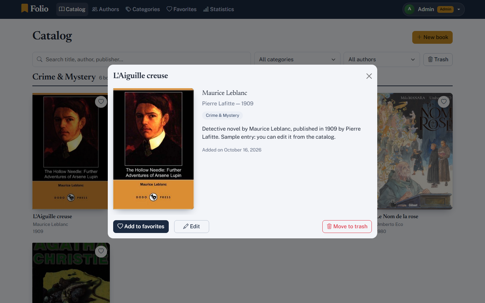 | 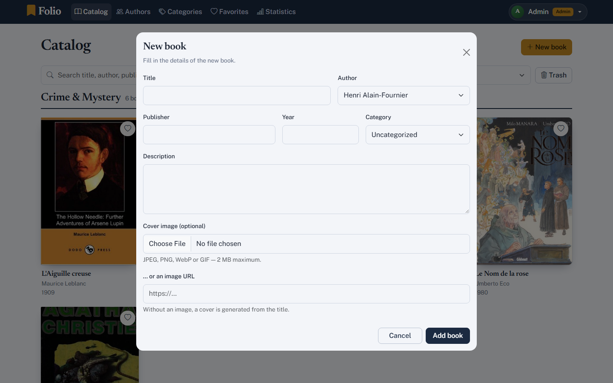 |

| Categories | Authors with search |
|:--:|:--:|
| 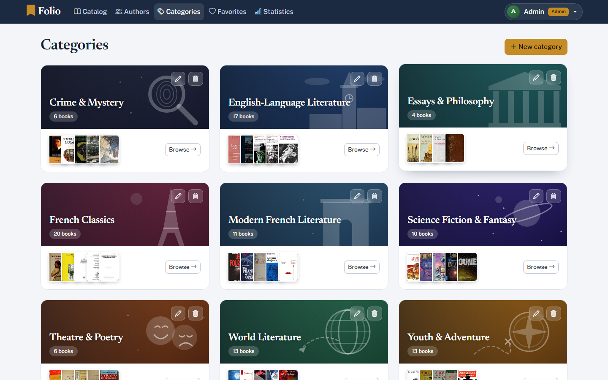 | 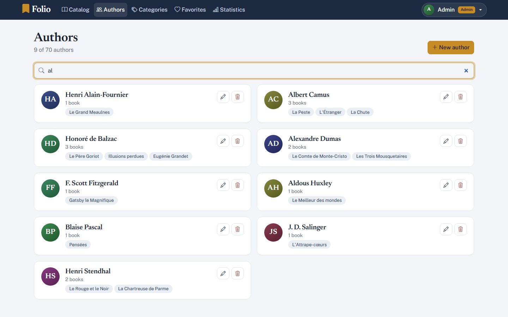 |

| Favorites | Profile |
|:--:|:--:|
| 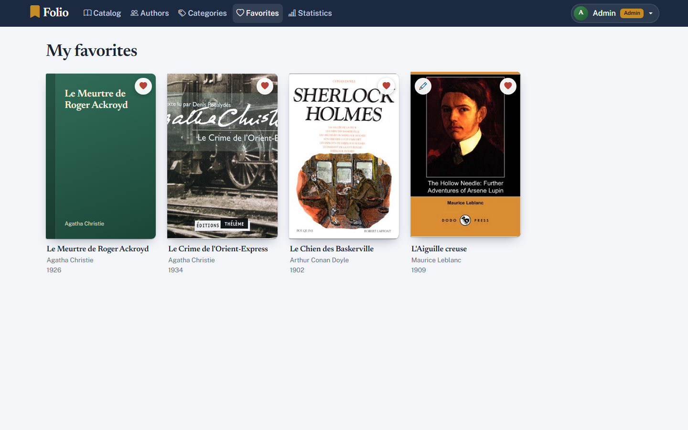 | 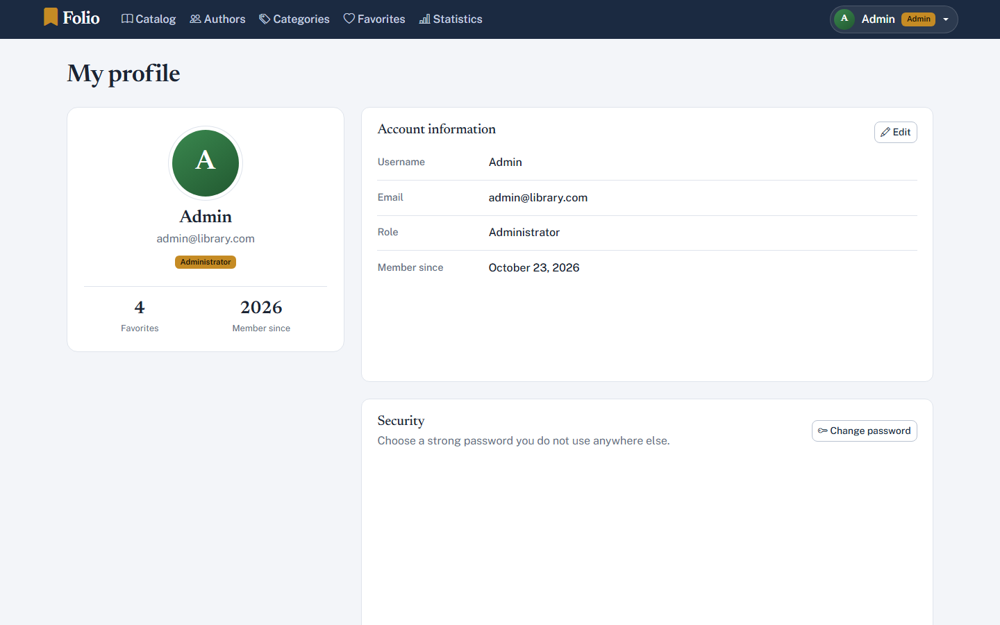 |

**Statistics dashboard (admin)**


**Swagger / OpenAPI documentation** — available at `/api`

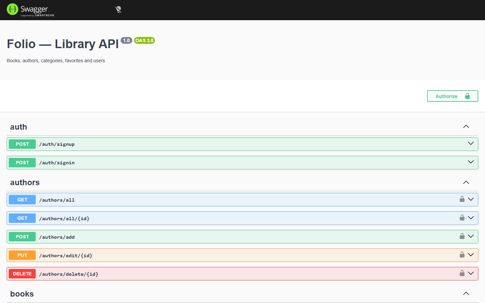

---

## Features

**Catalog**
- Books grouped into one section per category, with covers
- Single-row toolbar: search, category filter, author filter
- Removable filter pills with a live result count
- Generated cover artwork when a book has no image
- Book details dialog with description, publisher, year and category

**Favorites**
- One-click favorite toggle, with a dedicated favorites page
- A book can be favorited once per user (database-level unique constraint)

**Administration**
- Create, edit and delete books, authors and categories
- All forms open in modals and only appear on demand, with inline validation
- Soft delete to a **trash**, restore, or permanent delete
- Automatic nightly purge of books trashed for more than 30 days
- Cover upload (file) or cover by URL
- Statistics dashboard built with Chart.js

**Accounts**
- Sign up / sign in with email *or* username
- Profile page: edit username and email, change password
- bcrypt-hashed passwords, JWT sessions

**Categories page**
- One card per category with a themed illustration, book count and a stack of covers

---

## Quick start

### Requirements
- Node.js 20+ and npm
- PostgreSQL 16+ (or Docker)

### 1. Install

```bash
git clone https://github.com/AjmiOns/folio-library.git
cd folio-library
npm install
```

### 2. Configure

```bash
cp .env.example .env        # PowerShell: copy .env.example .env
```
Edit `.env` and set a long random `JWT_SECRET`.

### 3. Start PostgreSQL

With Docker:
```bash
docker compose up -d
```
Without Docker, create the role and database once:
```sql
CREATE USER folio WITH PASSWORD 'folio';
CREATE DATABASE folio OWNER folio;
```

### 4. Run

```bash
npm run start:dev
```

| URL | What |
|---|---|
| http://localhost:3000 | Application |
| http://localhost:3000/api | Swagger UI |

Tables are created automatically on first start (`DB_SYNC=true`, development only).

### 5. Create your admin account

Open the app → **Create one** → register. This first account is the administrator.

### 6. Load sample data (optional)

```bash
npx ts-node src/seed.ts               # 100 books, 70 authors, 9 categories, covers from Open Library
npx ts-node src/seed.ts --no-covers   # offline: skip cover download
```
The seed is **idempotent**: running it again never duplicates data; it only fills in missing categories and covers.

### Scripts

| Command | Purpose |
|---|---|
| `npm run start:dev` | Development server with watch mode |
| `npm run build` | Compile to `dist/` |
| `npm run start:prod` | Run the compiled build |

---

## Architecture

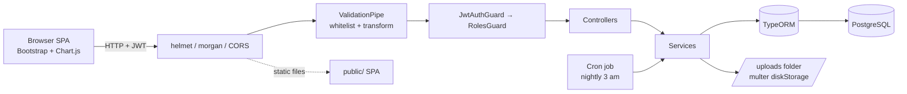

**Layered by feature module** — each module (`auth`, `user`, `author`, `category`, `book`, `favorite`, `tasks`) owns its entity, DTOs, service, controller and module file. Controllers stay thin (routing, guards, DTOs); business rules live in services.

---

## Data model

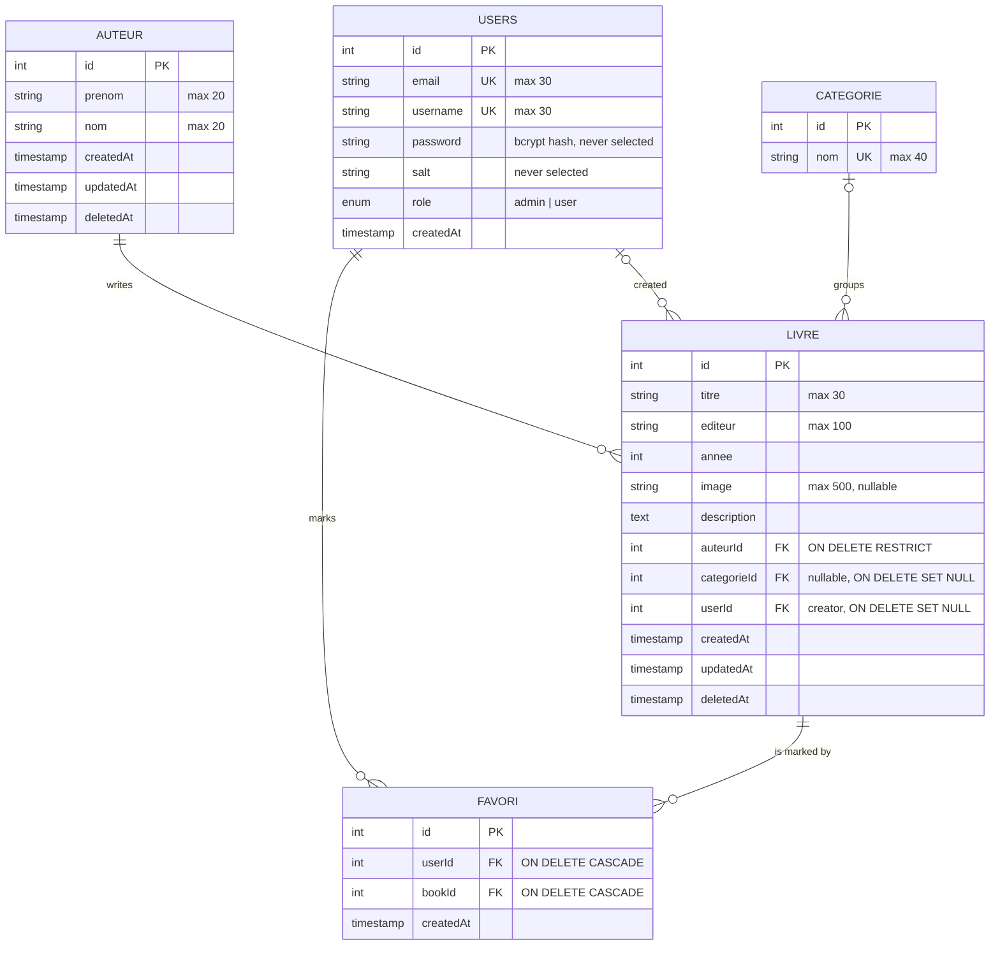

- `createdAt / updatedAt / deletedAt` come from a shared abstract `Timestamp` class (`@DeleteDateColumn` enables soft delete).
- `FAVORI` has a composite `UNIQUE(userId, bookId)`.
- The table `user` from the specification is named `users` because `user` is a reserved word in PostgreSQL.

---

## Roles and permissions

| Action | Visitor | User | Admin |
|---|:--:|:--:|:--:|
| Sign up / sign in | ✅ | ✅ | ✅ |
| Browse books, authors, categories | ❌ | ✅ | ✅ |
| Upload / view cover images | ❌ | ✅ | ✅ |
| Manage own favorites | ❌ | ✅ | ✅ |
| Edit own profile / password | ❌ | ✅ | ✅ |
| Create / edit / delete books | ❌ | ❌ | ✅ |
| Trash: list, restore, permanent delete | ❌ | ❌ | ✅ |
| Create / edit / delete authors | ❌ | ❌ | ✅ |
| Create / rename / delete categories | ❌ | ❌ | ✅ |
| View statistics | ❌ | ❌ | ✅ |

Permissions are enforced **on the server** (`JwtAuthGuard` + `RolesGuard` + `@Roles`), and mirrored in the UI.

---

## API reference

Interactive documentation: **`GET /api`** (Swagger, with Bearer authentication).

### Auth and profile

| Method | Route | Access | Description |
|---|---|---|---|
| POST | `/auth/signup` | Public | Register (`email`, `username`, `password`) |
| POST | `/auth/signin` | Public | Sign in with `login` (email or username) + `password` → `{ accessToken, user }` |
| GET | `/profile` | User | Current profile and favorites count |
| PATCH | `/profile` | User | Update `username` / `email` |
| PATCH | `/profile/password` | User | Change password (requires current password) |

### Books

| Method | Route | Access | Description |
|---|---|---|---|
| GET | `/books/all` | User | List books (`?trashed=true`: admin only) |
| GET | `/books/all/:id` | User | One book |
| GET | `/books/stats` | Admin | Dashboard figures |
| POST | `/books/upload` | User | Upload a cover (`file`, JPEG/PNG/WebP/GIF, 2 MB max) |
| GET | `/books/images/:filename` | User | Serve an uploaded cover |
| POST | `/books/add` | Admin | Create a book |
| PUT | `/books/edit/:id` | Admin | Update a book |
| DELETE | `/books/softdelete/:id` | Admin | Move to trash |
| DELETE | `/books/delete/:id` | Admin | Delete permanently |
| PATCH | `/books/recover/:id` | Admin | Restore from trash |

### Authors, categories, favorites

| Method | Route | Access | Description |
|---|---|---|---|
| GET | `/authors/all`, `/authors/all/:id` | User | List / read authors (with their books) |
| POST | `/authors/add` | Admin | Create |
| PUT | `/authors/edit/:id` | Admin | Update |
| DELETE | `/authors/delete/:id` | Admin | Delete (409 if books still reference the author) |
| GET | `/categories/all` | User | List categories |
| POST | `/categories/add` | Admin | Create |
| PUT | `/categories/edit/:id` | Admin | Rename |
| DELETE | `/categories/delete/:id` | Admin | Delete (its books become uncategorized) |
| GET | `/favorite/all` | User | My favorites |
| POST | `/favorite/add/:bookId` | User | Add a favorite (409 if already present) |
| DELETE | `/favorite/delete/:bookId` and `/favorite/add/:bookId` | User | Remove a favorite |

### Example

```bash
# sign in
curl -X POST http://localhost:3000/auth/signin \
  -H "Content-Type: application/json" \
  -d '{"login":"admin@example.com","password":"s3cret-pass"}'

# use the token
curl http://localhost:3000/books/all -H "Authorization: Bearer <accessToken>"
```

---

## Security

| Concern | Measure |
|---|---|
| Password storage | bcrypt with a per-user salt (10 rounds); `password` and `salt` columns are `select: false` and never leave the database |
| Authentication | JWT bearer tokens, configurable lifetime (24 h by default) |
| Authorization | Role guard on every protected route; role is re-read from the database on each request, so changes apply immediately |
| Input validation | Global `ValidationPipe` with `whitelist` and `forbidNonWhitelisted`; `class-validator` DTOs enforce the length limits from the specification |
| HTTP hardening | `helmet` with a Content-Security-Policy restricted to self + the CDNs the UI uses |
| Request logging | `morgan` |
| File uploads | MIME-type allow-list, 2 MB limit, random UUID file names, `basename()` against path traversal, images only served to authenticated users |
| Enumeration | Generic "Invalid credentials" message for unknown user or wrong password |
| XSS | All dynamic values are HTML-escaped in the frontend |
| Referential integrity | Foreign-key actions chosen per relation (RESTRICT, SET NULL, CASCADE) |

---

## Specification compliance

Traceability against the course specification (*CIMP NestJS — Nidhal Jelassi*).

| Requirement | Status | Notes |
|---|:--:|---|
| Sign up / sign in; first account is admin | ✅ | `auth.service.ts` |
| Visitors, users and admins with distinct rights | ✅ | Guards + `@Roles` |
| Data model: user, auteur, livre, favori | ✅ | See [Data model](#data-model) |
| `Timestamp` base class (created / updated / deleted) | ✅ | `common/timestamp.entity.ts` |
| `UNIQUE(user, book)` on favorites | ✅ | `favorite.entity.ts` |
| All listed endpoints | ✅ | See [API reference](#api-reference) |
| Soft delete, permanent delete, recover | ✅ | Books |
| `class-validator` / `class-transformer` | ✅ | DTOs + global pipe |
| Upload with Multer (`FileInterceptor` + `diskStorage`) | ✅ | `book/upload.config.ts` |
| `@nestjs/schedule` | ✅ | Nightly trash purge |
| Swagger at `/api` | ✅ | `@nestjs/swagger` |
| helmet + morgan | ✅ | Used directly (see below) |
| PostgreSQL instead of MySQL | ⚠️ | Requested change; `pg` driver |

**Deliberate deviations and additions**

- **PostgreSQL** replaces MySQL. The `user` table is named `users` (reserved word).
- **helmet and morgan are wired directly** in `main.ts`. The `@nest-middlewares/*` wrappers are deprecated and incompatible with helmet 8; the underlying packages are identical.
- **NestJS 11** is used. Bump the `@nestjs/*` packages to the version your environment requires.
- **`/books/stats` is admin-only** (the specification allowed any authenticated user).
- **Beyond the specification:** categories, profile management, statistics dashboard, author search, themed category artwork, seed script with Open Library covers, trash purge job.

---

## Project structure

```
folio-library/
├── src/
│   ├── main.ts                  # bootstrap: helmet, morgan, CORS, pipes, static, Swagger
│   ├── app.module.ts
│   ├── seed.ts                  # sample data (100 books, categories, covers)
│   ├── auth/                    # signup / signin, JWT strategy
│   ├── user/                    # entity, profile endpoints
│   ├── author/
│   ├── category/
│   ├── book/                    # CRUD, trash, upload, images, stats
│   ├── favorite/
│   ├── tasks/                   # scheduled trash purge
│   └── common/                  # Timestamp base, guards, decorators
├── public/                      # single-page frontend
│   ├── index.html
│   ├── css/style.css
│   └── js/app.js
├── docs/screenshots/
├── docker-compose.yml           # PostgreSQL 16
├── .env.example
└── README.md
```

**Frontend routes** (hash-based): `#/login`, `#/signup`, `#/books`, `#/authors`, `#/categories`, `#/favorites`, `#/stats` (admin), `#/profile`.

---

## Configuration

| Variable | Default | Description |
|---|---|---|
| `PORT` | `3000` | HTTP port |
| `DB_HOST` | `localhost` | PostgreSQL host |
| `DB_PORT` | `5432` | PostgreSQL port |
| `DB_USER` | `folio` | Database user |
| `DB_PASSWORD` | `folio` | Database password |
| `DB_NAME` | `folio` | Database name |
| `DB_SYNC` | `true` | Auto-create / alter tables. **Development only.** |
| `JWT_SECRET` | — (required) | Secret used to sign tokens |
| `JWT_EXPIRES_SECONDS` | `86400` | Token lifetime |

---

## Design decisions

- **Server-side authorization, UI as a convenience.** Hiding a button never replaces a guard.
- **Soft delete + trash** protects against accidental loss; a cron job keeps the trash from growing forever.
- **Author deletion is refused while books reference it** (trash included), instead of silently orphaning or cascading data.
- **Deleting a category keeps its books** (they become uncategorized).
- **Images behind the JWT.** The frontend fetches uploaded covers as blobs, so private files never leave the authenticated session. A book image may also be an external URL.
- **Vanilla JS frontend.** One small bundle-free SPA keeps the project easy to read and run: no build step for the UI.
- **Idempotent seed.** Safe to re-run at any time; it also upgrades older sample data.

---

## Known limitations and roadmap

- No automated tests yet — next step: unit tests for services and e2e tests for auth and role rules.
- `DB_SYNC` is convenient for development; production should use TypeORM **migrations**.
- No pagination yet; the catalog loads all books (fine for hundreds, not tens of thousands).
- No refresh tokens or login rate limiting.
- Roadmap ideas: pagination and server-side search, reading lists, ratings, CSV import, Docker image for the API, CI pipeline.

---

## Credits

- Course project: **CIMP NestJS** — specification by Nidhal Jelassi.
- Cover images from the [Open Library Covers API](https://openlibrary.org/dev/docs/api/covers).
- UI: [Bootstrap](https://getbootstrap.com), [Bootstrap Icons](https://icons.getbootstrap.com), [Chart.js](https://www.chartjs.org); fonts Newsreader and Public Sans.

---

## Author

**Ajmi Ons**<br>
Cloud Infrastructure Management Engineering Student at TEK-UP University, Tunisia.

- 🐙 GitHub: [AjmiOns](https://github.com/AjmiOns)
- 💼 LinkedIn: [Ons Ajmi](https://www.linkedin.com/in/ons-ajmi--/)

This project was designed and built as part of the **CIMP NestJS** course.
